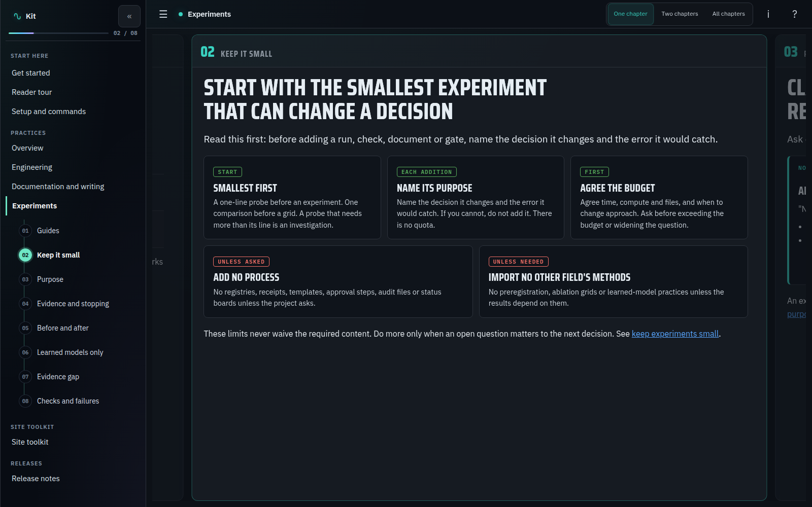

# Engineering and documentation kit

Reusable engineering and documentation policy, a complete HTML reader and a
small static-site toolchain. Projects consume one pinned [Git submodule](https://git-scm.com/book/en/v2/Git-Tools-Submodules) while keeping their own
topic records, pages, figures, navigation and evidence.



The kit carries the existing chapter reader and build-sheet layout: full-width
cards, docked navigation, one/two/all-chapter views, pinned comparisons, optional
reading layers, code highlighting, local math rendering, diagrams, figure
controls, carousels, lightboxes and locally bundled fonts. It needs no JavaScript
package installation for building a site.

Independent comparisons can use the shared [panel switcher](docs/topics/panel-switcher/panel-switcher.md),
including button controls, hash reveal, print restoration and no-script reading.

## Start a project

Add this repository at `.docs-kit` using its shared repository URL:

```bash
git submodule add <shared-repository-url> .docs-kit
git submodule update --init --recursive
python3.12 -m venv .build/docs-env
.build/docs-env/bin/python -m pip install -r .docs-kit/requirements.txt
.build/docs-env/bin/python .docs-kit/docsite.py init . --title "My project" --repository https://github.com/owner/repo
```

`init` adds the starter only after checking every destination. It refuses to
overwrite existing files. It writes the title (default: the folder name) and the
source repository into `docs/site/site.toml`. For an existing documentation system, keep its
content, add the configuration deliberately and follow [adoption](rules/maintenance.md).

For local-only use, add the kit with
`git -c protocol.file.allow=always submodule add /path/to/documentation-kit .docs-kit`.
Use a shared remote URL when distributing consuming repositories to others.

Review `docs/site/site.toml`: the sidebar home label, source ref and navigation. Set `page_css = ["build-sheet.css"]` on pages
that use the shared layout. Add `.build/` to the project's `.gitignore`, then
track the authored sources before building:

```bash
git add docs AGENTS.md CLAUDE.md .gitmodules .docs-kit
.build/docs-env/bin/python .docs-kit/docsite.py build --project .
.build/docs-env/bin/python .docs-kit/docsite.py lint --project . --strict
python3.12 -m http.server 8321 --bind 127.0.0.1 --directory .build/docs
```

Open `http://127.0.0.1:8321/html/guide.html` to inspect the starter. The home
page is `html/index.html`. The server exposes generated output only.

For a separate public bundle, configure `[publication]` in `docs/site/site.toml`
and run `python .docs-kit/docsite.py publish --project . --out _site`. The kit
builds and exports the bundle. The project declares its public pages, admitted
files and private-source policy. See
[configured publication](rules/site/publication.md#configured-publication).

## Ownership

| Shared kit | Each project |
|---|---|
| `rules/`: canonical engineering, documentation, writing and site practices | `docs/PROJECT_CONTEXT.md` and `docs/index.md`: orientation, reading routes and project-specific additions |
| `theme/`: HTML shell, chapter reader, common CSS/JS, fonts and math assets | `docs/topics/`: records and optional rendered `index.md` pages |
| `tooling/` and `docsite.py`: renderer, packaging and checks | `docs/site/site.toml`, local CSS/components/fragments, `docs/figures/` |
| `examples/starter/`: authoring reference and initial project skeleton | `docs/development/` when needed, open plans, evidence, dated sessions and `docs/worklog.md` |

The starter uses one [task router](examples/starter/AGENTS.md.tmpl) with named paths
for Codex and a [Claude import](examples/starter/CLAUDE.md.tmpl) of that same router.
The starter's entry files (`AGENTS.md`, `CLAUDE.md`, `docs/PROJECT_CONTEXT.md`,
`docs/index.md`, `docs/worklog.md`, `docs/open/OPEN.md` and `docs/site/site.toml`)
are stored as `*.tmpl`, so none is live inside `.docs-kit/`; `init` writes them
under their real names, with `--title` and `--repository` filled into
`site.toml`.
Read the shared rules before the actions named by the router. Keep project
exceptions in project-owned records. Change common rules in this repository.

The [shared Git guide](rules/engineering/git.md) covers commit scope, required
explanatory message bodies, validation, shared staging areas and history.
Projects route contributors to it before Git actions and keep concrete test
commands and acceptance gates in their own records.
The [delivery guide](rules/engineering/delivery.md) covers assignment scope,
owner responsibility, coordination, parallel work and escalation.
The [handoff guide](rules/engineering/handoffs.md) covers completion, blockers,
supporting records and receipt of work.

## Focused guides

Read only the guides matching the action. [Documentation reading index](docs/KIT_INDEX.md)
links to the kit's contracts, evidence and chronology.

| Area | Guides |
|---|---|
| Engineering | [Code and generated files](rules/engineering/code.md), [performance](rules/engineering/performance.md), [execution and resources](rules/engineering/execution.md) |
| Experiments | [Workflow](rules/experiments/workflow.md), [proportionate verification](rules/experiments/verification.md) |
| Delivery | [Ownership](rules/engineering/delivery.md), [handoffs](rules/engineering/handoffs.md), [Git](rules/engineering/git.md) |
| Documentation | [Canonical homes and lifecycle](rules/documentation.md) |
| Writing | [Pages and review](rules/writing/pages.md), [explanations](rules/writing/explanations.md), [measurements](rules/writing/evidence.md), [figures and access](rules/writing/figures.md), [math](rules/writing/math.md), [code and diagrams](rules/writing/code.md) |
| Site | [Authoring](rules/site/authoring.md), [validation](rules/site/validation.md), [resources](rules/site/resources.md), [publication](rules/site/publication.md), [reader](rules/site/reader.md) |

The original [writing](rules/writing.md) and [maintenance](rules/maintenance.md)
entrypoints remain short routers with their existing section anchors. Projects
keep concrete tools, workloads, resource profiles, acceptance thresholds and
runtime requirements in their own records.

The experiment guides define shared purposes and verification choices once.
Projects link to them and retain local questions, selected recipes, decisions
and accepted execution contracts.

## Pin and upgrade

A project records the kit's exact commit as its submodule pointer. Changes here
do not silently upgrade consumers. Clone consuming repositories recursively:

```bash
git clone --recurse-submodules <project-url>
```

To adopt a reviewed kit update:

```bash
git -C .docs-kit fetch --tags
git -C .docs-kit checkout <reviewed-kit-commit-or-tag>
.build/docs-env/bin/python .docs-kit/docsite.py build --project .
.build/docs-env/bin/python .docs-kit/docsite.py lint --project . --strict
git add .docs-kit
```

The kit is versioned in `VERSION` and tagged `v<version>`. [Releases and
upgrades](docs/topics/releases/releases.md) lists what each version changes for
consumers and the migration steps; 1.0.0 is the first stable version.
The current 2.0.0 release has a [consumer migration guide](docs/topics/releases/migrations/2.0.0.md); the [1.1.0 guide](docs/topics/releases/migrations/1.1.0.md) covers the earlier step.
The [2.1.0 guide](docs/topics/releases/migrations/2.1.0.md) covers the changes on `main` that are not tagged yet.

Then run the [project conformance check](rules/conformance.md) and report its
findings. Review changed human pages at wide and narrow widths before committing the
pointer and any consumer adaptations together. Share common changes upstream;
avoid editing a consumer's detached submodule checkout as its only live copy.

## Commands

```bash
python .docs-kit/docsite.py build --project . --page guide
python .docs-kit/docsite.py build --project . --check
python .docs-kit/docsite.py lint --project . --registry
python .docs-kit/docsite.py slides --project . --select guide --select other#intro,result --out review --title "Review"
```

Python 3.12 is the validated runtime; the entrypoint requires at least 3.12.
Dependencies are pinned in `requirements.txt`. Node.js 22 is used for kit
development checks, not for building a consuming site.

The build packages tracked resources only, rejects missing media and symlink
escapes, checks resource closure and detects stray generated files. Local-only
captures require explicit configuration. Optional `evidence_manifests` enable
exact-byte verification without requiring any platform-specific collection.
See [maintenance](rules/maintenance.md) for source paths and extension points.

Chapters can open with a 16:9 [slide face](rules/site/authoring.md#slide-faces-and-decks);
the `slides` command collects faces from any reader or card-structured pages into a presentable, printable deck
under `.build/slides/`.

Existing sites can use the shared [publication exporter](rules/site/publication.md#exporting-into-an-existing-publication)
to preserve their public routes and selected evidence. The
[browser-check helpers](rules/site/validation.md#reusable-browser-checks) support
project harnesses without moving their domain assertions. Homepage composition
stays [project-owned](rules/writing/pages.md#project-owned-homepages); the starter is
optional.

## Develop the kit

```bash
python -m pip install -r requirements.txt
bash tests/run_checks.sh
```

`tests/run_checks.sh` generates the starter with `init` under `.build/starter/`,
builds and lints it, runs the unit tests against it, then builds and checks the
kit's own [reference website](docs/topics/website/website.md) and the Node checks.
The kit's own entry files use `KIT_` names (`docs/KIT_CONTEXT.md`,
`docs/KIT_INDEX.md`, `docs/KIT_WORKLOG.md`, `docs/open/KIT_OPEN.md`) so they are
never mistaken for a consuming project's files. The kit site renders this README
and the guides in `rules/` as reference pages.
The independent-consumer tests create disposable Git repositories. Build output
stays under each consumer's `.build/docs/`; tools never infer the consumer from
where the kit happens to be installed.

The script then checks that every shared script parses and runs the four
real-browser suites when Playwright resolves. Playwright and Chromium come from
the development environment:

```bash
DOCS_PLAYWRIGHT=/path/to/playwright DOCS_CHROMIUM=/path/to/chromium DOCS_NODE=/path/to/node22 bash tests/run_checks.sh
```

Without Playwright the script prints that the browser suites were skipped.
`DOCS_REQUIRE_BROWSER=1` turns that into a failure. The Pages workflow sets it,
so a push to `main` publishes only when every check passes, browser suites
included.

The suites are `tests/visual_review.cjs`, `tests/test_browser_checks.cjs`,
`tests/test_panel_switcher.cjs` and `tests/own_site_review.cjs`; together they
take about two minutes. The script gives each a 280-second limit, sets
`DBUS_SESSION_BUS_ADDRESS=unix:path=/nonexistent-docs-kit-review` so Chromium
does not reach the desktop session, and uses a 4G memory cap without swap when
`systemd-run --user` is available. To run one suite alone, keep the same
containment:

```bash
systemd-run --user --scope --quiet -p MemoryMax=4G -p MemorySwapMax=0 timeout 280 node tests/own_site_review.cjs
```

Each suite starts an owned loopback server, checks desktop/phone and paired
layouts, mobile table scrolling and no-JavaScript reading, then closes browser
and server. Screenshots stay under `.build/visual-review/`. Passing suites do
not replace the [by-eye review](rules/site/validation.md#validation-and-review)
of a visual change.

## Provenance

Extracted from the Autonomous Driving Platform documentation system on
2026-11-04. The extraction record, source hashes, policy coverage map and
initial check receipts were removed after 1.1.0; they remain at the
[`v1.1.0` tag](https://github.com/davszi/documentation-kit/tree/v1.1.0). This
repository contains shared rules and presentation code, not simulator code,
research results or historical evidence collections.

## License

The kit's own rules, tooling, theme and starter are under the
[MIT License](LICENSE). Bundled fonts and KaTeX keep their own licenses: vendor
licenses and source notes are retained beside their assets; see
[third-party notices](THIRD_PARTY.md). Every built site carries the kit's
license at `html/assets/documentation-kit/LICENSE`, beside the vendor licenses
under `html/assets/fonts/` and `html/assets/katex/`.
