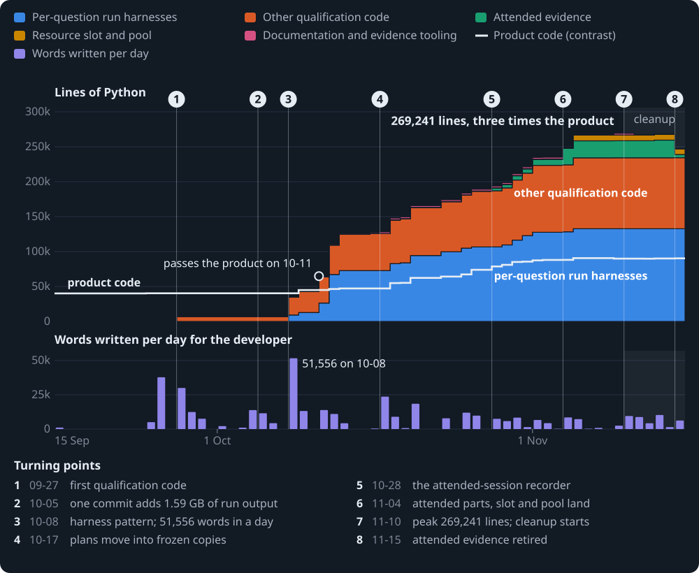

# Approval that failed open: how ADP's supporting code piled up

**Result.** ADP's approval step existed, but it failed open: agents wrote more
plans and reports than one person can read, so the developer said yes to
proposals he had not read in full, and work went ahead. Each step was
reasonable on its own. Code and documents were added and not removed, and
nobody added up the total. Between 2026-09-24 and 2026-11-10 the supporting
code grew from 832 to 269,241 lines of Python, three times the product code,
and a cleanup from 2026-11-10 deleted 145,353 lines but left the largest
pile, the per-question run harnesses, in place.

**Measured** means counted from ADP's Git history (`main` at `b8b80e0b`, on
2026-11-15); **the developer** marks his own words, quoted verbatim;
**interpretation** marks a reading that may be wrong. "The developer" is the
person who owns ADP and the kit; "agents" are the AI sessions that did the work.

## Timeline

**Figure 1.** Supporting code by group against product code (white line),
and words written for the developer per day. Measured. Narrow version:
[pileup-upright.svg](figures/pileup-upright.svg); generator:
[draw_figures.py](draw_figures.py), which also draws the
[page's](index.md) other figures.

The product grows too, from 40,254 to 90,261 lines, but the stack passes it on
2026-10-11 and has no downward step before 2026-11-11. After the cleanup it
is 8.2 % below its peak. Most words were written before most of the code.

| # | Date | What happened (measured) |
|---|---|---|
| 1 | 2026-09-27 | First qualification code: supporting code 832 → 7,976 lines, after 42,773 words of plans on 09-24 and 09-25. |
| 2 | 2026-10-05 | One commit adds 22,378 run-output files, 1.59 GB. |
| 3 | 2026-10-08 | The per-question harness pattern appears. Largest day of writing: 51,556 words. |
| 4 | 2026-10-17 | Plans, 15,785 lines the day before, move into frozen copies. |
| 5 | 2026-10-28 | The attended-session recorder. |
| 6 | 2026-11-04 – 11-05 | Attended parts and the resource slot and pool land. ADP adopts the kit. |
| 7 | 2026-11-10 | Peak: 269,241 lines. The first of 34 net-removal commits. |
| 8 | 2026-11-15 | Attended evidence retired. Supporting code: 247,082 lines. |

## The piles

Measured sizes; peak with its date, then the state on 2026-11-15.

| Pile | What it was | Peak | Today | Kit rule |
|---|---|---|---|---|
| Per-question run harnesses | A probe, run, supervision and review module, with tests, for every question | 132,652 lines, 480 files (11-05) | 132,638 lines, still there | [Name the need first](../../../rules/engineering/code.md#name-the-need-first), [capability map](../../../rules/engineering/code.md#the-capability-map) |
| Other qualification code | Probes, plots, preview app, runtime environment | 101,630 lines (11-15) | 101,630 lines, still there | [Where code lives](../../../rules/engineering/code.md#where-code-lives), [step back](../../../rules/experiments/workflow.md#step-back-across-experiments) |
| Attended evidence | Prepares, launches, records and judges a session in which the developer clicks | 25,330 lines, 48 files (11-13) | Retired; 4,588 lines parked | [Show the total](../../../rules/experiments/workflow.md#show-the-total) |
| Frozen copies and evidence store | Byte-exact copies of finished plans, 53 manifest entries, a path translator; a central evidence store | 6,225 lines in 42 copies (11-09); store 92,813 lines | Deleted 11-11 | [Finished working documents](../../../rules/records.md#finished-working-documents) |
| Plans that never ended | `docs/open/` | 15,785 lines, 76 files (10-16) | 5,202 lines, 21 files | [Finished working documents](../../../rules/records.md#finished-working-documents) |
| Run output in Git | Whole run folders, source copies included | 6.26 GB (11-12) | 6.25 GB, 83,428 files, still there | [Numbers and staleness](../../../rules/records.md#numbers-and-staleness) |
| Resource slot and pool | A memory-capped slot, a native pool, an older slot and a usage cache | 8,151 lines (11-05) | 8,063 lines; older slot and cache use removed 11-15 | [Name the need first](../../../rules/engineering/code.md#name-the-need-first) |
| A branch and worktree per task | Agents isolated even work done alone | Not measured | Rule added | [Parallel work](../../../rules/engineering/delivery.md#parallel-work) |

Two piles are easy to miss because nothing removed them: the harnesses and
the other qualification code, 132,638 and 101,630 lines, are still in the
repository. The cleanup removed 14 harness lines.

## Why it happened

**More text than one person can read.** Measured: in the 47 days from
2026-09-24 to 2026-11-09 agents added 354,333 words to plans, the worklog and
session notes, 7,539 words per calendar day. The developer: "we can also
clearly say that I didnt maange to read all the agents proposals cuz its too
mcuh for a human and they ended up building this mess under mynose".
Interpretation: approval depended on reading, so when the text outgrew
reading, the step let work through.

**Yes without reading.** The developer: "i most probably said yes without
seeing or understanding it all". Measured, first half: the build-up's records
carry 181 approval statements, 177 of them about "the user", "owner" or
"human", yet only 3 of 499 commit messages cite a decision; in the cleanup,
80 of 125 do. Second half: for six builds, the harness pattern, run output in
Git, the frozen copies, the recorder, the pool and slot, and the evidence
store, the search found no approval in Git within seven days before the first
file. The exception is the attended parts ("lets build it now fully",
11-02). Interpretation: records and memory differ, and Git cannot settle it.
Agents wrote the approval statements, approvals given in chat are not in Git,
and Git does not show what the developer read.

**A general need solved inside one experiment.** The developer: "i think
another failure is that we build something for a single experiment instead of
looking for the big picture". Measured: every question got its own harness
modules, 480 files by 2026-11-05. Interpretation: a need met once was met
again, because nothing showed it had been met before.

**Nothing removed, no total.** Measured: the supporting code total did not
fall on any day before 2026-11-11. Interpretation: each addition answered a
real problem of its day, and no record showed the running total that would
make someone ask whether the whole was worth its cost.

**The kit's own part.** The kit was extracted from ADP on 2026-11-04 and
carried some habits as shared rules and tools. Measured in the kit's history:
its first commit had a rule for frozen records, replaced on 2026-11-11; three
adapter hooks let old copies pass the link check, and a second project came
to use two of them; a number-ledger tool that no project imported lived from
2026-11-06 to 11-09; and a fixed slide-face arrangement drawn from one deck
lasted from 2026-11-12 to 11-14, met by none of 36 faces on another project.

## What the cleanup took

From Git only; the developer's hours were not recorded.

- 125 commits from 2026-11-10 to 11-15; 34 net-removal commits deleted
  145,353 lines and 221 files.
- Largest removals: the evidence store, 92,813 lines; attended evidence,
  18,459 and 8,814 lines; the frozen copies, 14,166 lines.
- From 2026-11-04, when ADP adopted the kit: 40 net-removal commits, 243,416
  lines; building and cleanup overlapped until 11-09.
- Agents wrote another 40,447 words in the 6 cleanup days.
- Run output grew: one cleanup commit stored 325 MB more, on the developer's
  word ("Yes, store it").

## What changed in the kit

- [Finished working documents](../../../rules/records.md#finished-working-documents):
  delete a finished plan and cite it from Git.
- [Numbers and staleness](../../../rules/records.md#numbers-and-staleness):
  what run output is kept, and when a source pin replaces a source copy.
- [Where code lives](../../../rules/engineering/code.md#where-code-lives),
  [name the need first](../../../rules/engineering/code.md#name-the-need-first)
  and [the capability map](../../../rules/engineering/code.md#the-capability-map).
- [Show the total](../../../rules/experiments/workflow.md#show-the-total) and
  [step back across experiments](../../../rules/experiments/workflow.md#step-back-across-experiments).
- [Parallel work](../../../rules/engineering/delivery.md#parallel-work): work
  alone stays in the checkout.
- [Reporting completion](../../../rules/engineering/handoffs.md#reporting-completion):
  full paths in reports.

## Recognising it early

Interpretation, from this timeline:

- Plans grow by thousands of words a day for weeks.
- Approvals appear as "user-approved" labels or one-word answers, and commit
  messages do not cite them.
- Supporting code passes the product code, and no record states its total.
- A second experiment builds its own harness instead of reusing one.
- A finished plan is frozen instead of deleted, and tools appear to keep the
  copies working.

## Not solved or not known

- The harnesses, the other qualification code, 8,063 lines of pool code and
  6.25 GB of run output are still in the repository.
- Whether the new rules change what agents build has not been observed.
- The developer's hours were never recorded. The 18 attended sessions ran
  13,640.3 s in total; that is their run time, not his time.
- Under discussion, not rules: an approval covers only what the ask said; an
  ask states the size of what it would build. Both are open questions for the
  developer in [approval scope and ask size](../../open/approval-scope-and-ask-size.md).
- The approval search reads keywords; a hand check found 24 of 25 matches to
  be real approvals.

## What worked

- The core of the resource slot, a memory-capped user scope, stays ADP's
  supported way to run checks and recorded successful runs.
- Three attended sessions passed their smaller question.
- The cleanup recorded its decisions in 80 of 125 commit messages.

## Sources

Measurement: `measurement/` (CSV files, [method.md](measurement/method.md),
[events.md](measurement/events.md), scripts). Every number here:
[numbers.md](numbers.md), written and checked by [numbers.py](numbers.py).
For each pile in detail, the evidence and the limits of the measurement, see
[background.md](background.md). The page for people is [index.md](index.md).
