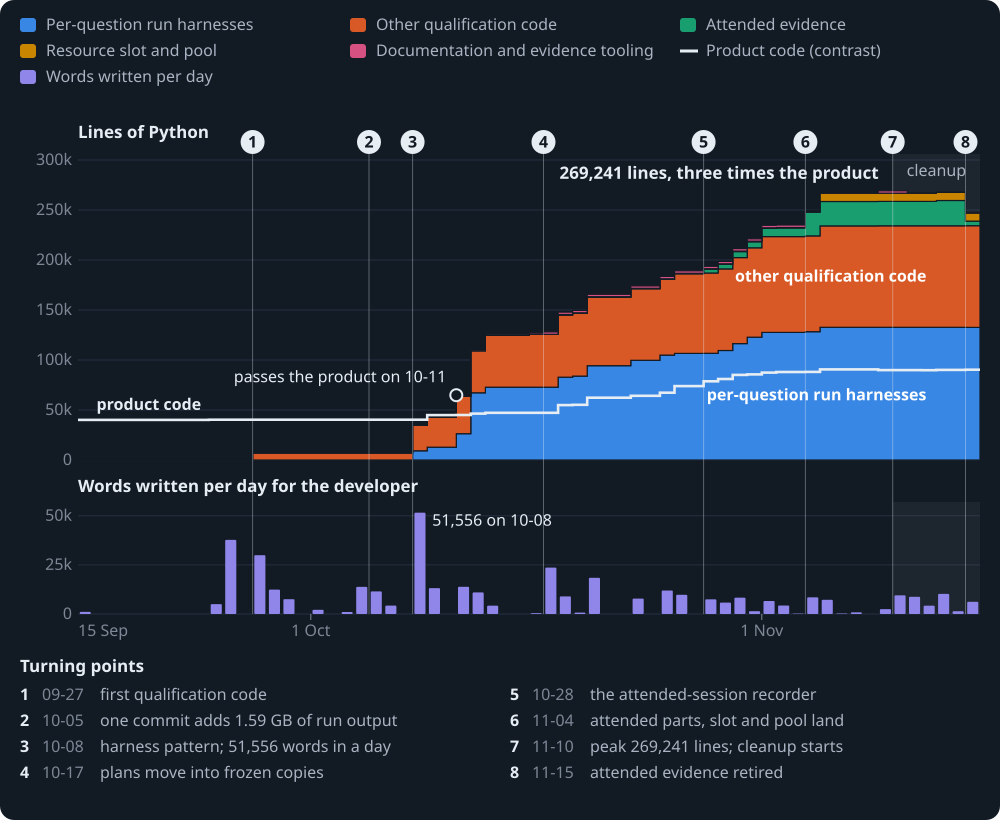

# Background: how ADP's supporting code piled up

This is the long form of [the record](approval-failed-open.md): each pile in detail, the
causes with their evidence, and the sources. The record is complete without
it; read this only for detail.

**Result.** ADP's approval step existed, but it failed open: agents wrote more
plans and reports than one person can read, so the developer said yes to
proposals he had not read in full, and work went ahead. Each step was
reasonable on its own. Code and documents were added and not removed, and
nobody added up the total. Between 2026-09-24 and 2026-11-10 the supporting
code grew from 832 to 269,241 lines of Python, three times the product code,
and a cleanup from 2026-11-10 deleted 145,353 lines but left the largest
pile, the per-question run harnesses, in place.

ADP is the project this kit was extracted from. This record explains why
several of the kit's rules exist, so that a reader, person or agent, can see
the same pattern early in another project. It blames nobody: the people and
agents involved each followed the rules and habits they had.

## How to read this record

Statements are of three kinds, and each is marked:

- **Measured:** counted from ADP's Git history, first-parent chain of `main`
  at `b8b80e0b`, read-only, on 2026-11-15. The data files are in
  [measurement/](measurement/); [numbers.md](numbers.md) gives the column,
  row or computation behind every number here.
- **The developer:** his own words, quoted as he wrote them. Spelling is not
  corrected.
- **Interpretation:** a reading of the measurements. It may be wrong.

People are named by role: the developer, who owns ADP and also owns the kit,
and agents, the AI sessions that did the work. Where the kit's worklog says
"kit owner", it means the agent session that maintains the kit, here called
the kit's maintaining session.

Limits of the measurement, which apply throughout:

- Only Git was measured. Chats, agent transcripts, untracked folders, side
  branches before their merge and the developer's time are not in it.
- Code means Python files only. A file that moved counts as removed and as
  added. A day is the committer's calendar day; work done on a branch shows
  on the day it reached `main`.
- "Words written" counts the words on added lines of plans (`docs/open/`),
  the worklog and session notes. A rewritten paragraph counts again. No
  reading time is estimated.
- The approval search is a keyword search over added Markdown lines and
  commit messages. A hand check of 25 rows drawn at random from the build-up
  found 24 that record an approval or choice the person gave and one that
  names an approval still needed ([numbers.md](numbers.md#sample-for-the-approval-search)).
  An approval given only in chat is not in Git.

## Timeline

**Figure 1.** Supporting code against product code, and the words written
for the developer per day. Measured, `measurement/timeline.csv`. The upright
version for narrow screens is [pileup-upright.svg](figures/pileup-upright.svg);
the generator is [draw_figures.py](draw_figures.py). The numbers match the
turning points below.

Notice three things in Figure 1. The product line (white) grows too, from
40,254 lines on 2026-10-01 to 90,261, but the coloured stack passes it on
2026-10-11, two weeks after the first qualification code. The stack has no
downward step before 2026-11-11, the day after marker 7, and after the
cleanup it is still almost as high: it fell by 22,159 lines, 8.2 % of its
peak. The words panel peaks in late
September and early October, before most of the code was written.

Before the build-up, from 2026-07-01 to 2026-09-23, the product was
rewritten in 405 commits, and the supporting code stayed at 832 lines of
documentation tooling.

| # | Date | What happened (measured unless marked) |
|---|---|---|
| | 2026-09-24 – 09-25 | Plan drafting starts: 42,773 words in two days, 37,730 of them on 09-25. |
| 1 | 2026-09-27 | First code in `experiments/platform_qualification/`: supporting code 832 → 7,976 lines. |
| 2 | 2026-10-05 | One commit, `15d3e02a`, adds 22,378 run-output files, 1.59 GB. Run output in Git: 455 MB on 10-01, 4.00 GB on 10-05. |
| 3 | 2026-10-08 | The per-question harness pattern appears: 9,201 lines in 41 files. The largest day of writing: 51,556 words, 50,588 of them in plans. |
| | 2026-10-16 | Plans in `docs/open/` peak at 15,785 lines in 76 files. |
| 4 | 2026-10-17 | Plans move into frozen copies with location manifests; `docs/open/` falls to 2,704 lines. The central evidence folder `docs/evidence/` starts. |
| 5 | 2026-10-28 | The attended-session recorder: 3,780 lines on its first day. |
| | 2026-11-02 | Plan 11, attended evidence parts, is adopted. The developer, as the plan quotes him: "lets build it now fully". |
| 6 | 2026-11-04 – 11-05 | Attended parts land (8,609 → 23,624 lines); the resource slot and native pool land (751 → 8,151 lines). ADP adopts the shared kit on 11-04. |
| | 2026-11-09 | The central evidence store: one commit, `ff6ede7e`, adds 405 files, 224 MB. |
| 7 | 2026-11-10 | Supporting code peaks at 269,241 lines. The first of 34 net-removal commits. |
| | 2026-11-11 | The 53 frozen copies and the evidence store are deleted. |
| | 2026-11-12 | `0c1c2b99` adds 11,389 run-output files, 325 MB, on the developer's word: "Yes, store it". |
| 8 | 2026-11-15 | Attended evidence is retired; 4,588 lines are parked. Supporting code: 247,082 lines. |

## The piles

Each pile below names what it was, its size, what it bought, where it stands
on 2026-11-15 and the kit rule that answers it. Sizes are measured unless
marked.

### Per-question run harnesses: still there

- **What it was.** Every qualification question got its own probe, run,
  supervision and review module, in some folders also a protocol and an
  authority module, each with tests. None was retired when a question was
  answered.
- **Size and growth.** 9,201 lines in 41 files on 2026-10-08, 72,804 lines on
  10-13, 132,652 lines in 480 files on 11-05. 120 commits touched the group.
- **What it bought.** The qualification runs themselves. This record does not
  judge which of their results still matter.
- **Now.** 132,638 lines in 480 files: the cleanup removed 14 lines.
- **Kit answer.** [Name the need first](../../../rules/engineering/code.md#name-the-need-first),
  [the capability map](../../../rules/engineering/code.md#the-capability-map),
  [where code lives](../../../rules/engineering/code.md#where-code-lives) and
  [step back across experiments](../../../rules/experiments/workflow.md#step-back-across-experiments).

### Attended evidence

- **What it was.** A chain that prepares, launches, records and judges a
  session in which the developer clicks through the simulator app.
- **Size and growth.** 3,780 lines on 2026-10-28; 8,609 → 23,624 lines on
  11-04; peak 25,330 lines in 48 files on 11-13.
- **What it bought.** Taken from ADP's attended-sessions record of 2026-11-13
  (at commit `b68a1d02`, deleted in `3197ab3e`), not rechecked here: 18
  sessions were launched from 2026-10-28 to 2026-11-05; together they ran
  13,640.3 s. That is the run time of the 18 sessions, not a measure of the
  developer's time, which was never recorded. Under the older
  checks, 3 passed their whole, smaller question. Under Plan 11, none passed
  all parts. A session needed six preparation stages and two independent
  reviews before the developer could click. The record counts 10,125 lines of
  attended-only code and 7,194 lines of tests.
- **Now.** Retired on 2026-11-15. 4,588 lines in 6 files are parked as
  candidates for a run journal.
- **Kit answer.** [Show the total](../../../rules/experiments/workflow.md#show-the-total),
  which would have put the cost in front of the developer at each attempt, and
  [name the need first](../../../rules/engineering/code.md#name-the-need-first).

### Frozen copies, their path translator and hash lists, and the evidence store

- **What it was.** Finished plans were not deleted. On 2026-10-17 they were
  moved into `evidence/documents/` folders as byte-exact copies, with two
  `locations.json` manifests listing each copy's original path and hash. A
  path translator let the copies' old links pass the link check. The central
  evidence store under `docs/evidence/` grew beside them.
- **Size.** 41 files and 5,991 lines on 2026-10-17, with 51 manifest entries;
  53 entries from 10-18; 42 files and 6,225 lines on 11-09. On 11-09 one
  commit added the evidence store's generated lists, 224 MB with media.
- **What it bought.** From the kit worklog of 2026-11-11, measured by two
  sessions and not rechecked here: 164 of ADP's 3,946 links needed the path
  translator, and Git already returns the exact bytes of 52 of the 53
  documents. Interpretation: the machinery mostly duplicated what Git keeps.
- **Now.** Deleted on 2026-11-11: the copies with `1a541cf2` (14,166 lines,
  60 files), the evidence store with `a18d94e5` (92,813 lines). `docs/**/evidence/`
  still holds 128,526 lines in 405 files.
- **Kit answer.** [Finished working documents](../../../rules/records.md#finished-working-documents)
  and the source pin in [numbers and staleness](../../../rules/records.md#numbers-and-staleness).

### Plans that never ended

- **What it was.** Plans and proposals in `docs/open/`, and the worklog.
- **Size and growth.** `docs/open/` held 1,280 lines on 2026-09-23 and 15,785
  lines in 76 files on 10-16. That day one plan file was 185,782 bytes, 21,413
  words, and another 103,809 bytes. The worklog grew from 2,719 lines on
  10-01 to 10,835 lines.
- **What it bought.** The plans for the platform refactor and its
  qualification. Interpretation: they were not closed when their work landed;
  on 10-17 they were frozen instead (the pile above).
- **Now.** `docs/open/` holds 5,202 lines in 21 files. The worklog is
  append-only by rule and stays.
- **Kit answer.** [Finished working documents](../../../rules/records.md#finished-working-documents).

### Run output in Git: still there

- **What it was.** Run folders committed whole: measured data, logs, media
  and copies of the source tree.
- **Size and growth.** Files under `experiments/`: 188,187 bytes on
  2026-09-23, 455 MB on 10-01, 4.00 GB on 10-05, peak 6.26 GB on 11-12. One
  commit on 10-05 added 1.59 GB. On 10-08 another added 866 MB and Git LFS.
  Of today's total, `.npz` files are 2.73 GB, and 47,530 `.py` files make
  421 MB; the measurement notes say these are mostly source copies stored in
  run folders.
- **Approval.** The keyword search found no approval before 10-05. The
  worklog line "User requested all preserved work be committed" is dated
  10-08, after the large commits.
- **Now.** 6.25 GB in 83,428 files. The cleanup added to it: on 2026-11-12
  `0c1c2b99` stored 325 MB of run output on the developer's word, the same
  day the kit made storing run output a rule.
- **Kit answer.** [Numbers and staleness](../../../rules/records.md#numbers-and-staleness):
  run output that a stated number rests on is kept in the experiment folder;
  caches and environment copies are not run output; output that nothing
  rests on is proposed for deletion; keeping output outside Git is the
  person's decision, asked with its size. A source pin replaces copies of
  the source tree. The rule narrows what is kept; it does not shrink this
  pile by itself.

### The resource slot's cache and its dead older version

- **What it was.** A slot that runs a check or build under a memory limit,
  and a native pool that admits parallel simulator runs.
- **Size and growth.** 474 lines on 2026-10-18; 751 → 8,151 lines on 11-05.
- **Approval.** Two records of 2026-11-05 say "The human requested two
  simulator runs in parallel" and "The human requested updated budgets and
  isolation for two simulator runs". No statement found approves the pool,
  keeper, slot or ledger design.
- **Now.** On 2026-11-15 `b72475d9` replaced the CPU slot with a small one:
  CPU rows in the shared ledger had broken the attended chain. The older
  `legacy_cpu_slot.py` was deleted and the CPU slot stopped using the usage
  cache: 1,041 lines of the group removed. 8,063 lines in 25 files remain.
- **Kit answer.** [Name the need first](../../../rules/engineering/code.md#name-the-need-first)
  and [where code lives](../../../rules/engineering/code.md#where-code-lives).

### A branch and a worktree for every task

- **What it was.** From the kit worklog of 2026-11-14: the developer reported
  that agents used a separate branch and worktree for all work, also when
  they worked alone. No rule asked for it. The cause, read from the desktop
  app's tool description and not measured, is that a session started from a
  session in a worktree gets its own worktree by default.
- **Size.** Not measured: Git keeps no record of deleted branches or
  worktrees. On 2026-11-15 the ADP checkout has 2 local branches.
- **Kit answer.** [Parallel work](../../../rules/engineering/delivery.md#parallel-work):
  work alone happens in the checkout on its current branch. The rule does not
  reach a session a person starts by hand.

## Why it happened

### More text than one person can read

**Measured.** From 2026-09-24 to 2026-11-09, 47 days, agents added 354,333
words to plans, the worklog and session notes: 268,837 in plans, 83,278 in
the worklog and 2,218 in session notes. That is 7,539 words per calendar day.
Words were added on 35 of the 47 days; the median of those days is 7,529
words, and 12 days had 10,000 words or more. The largest day, 2026-10-08,
had 51,556 words.

**The developer:** "we can also clearly say that I didnt maange to read all
the agents proposals cuz its too mcuh for a human and they ended up building
this mess under mynose"

**Interpretation.** The approval step depended on the developer reading what
he approved. When the text outgrew his reading, the step did not stop work.
It let work through: it failed open.

### Yes without reading

**The developer**, asked whether he had approved plans he could not read in
full or agents had built without asking: "i most probably said yes without
seeing or understanding it all"

**Measured,** first half: during the build-up the records carry 181
statements that a person approved, chose or asked for something. 177 of them
say "the user", "owner" or "human"; 4 name the developer. Only 3 of the 499
commit messages cite a decision. In the cleanup, 80 of 125 commit messages
quote the developer's decision. Several recorded approvals quote the answer
itself, such as "Oke" and "yes".

**Measured,** second half: for six large builds the search found no approval
in Git in the seven days before or on the day their first file appeared: the
harness pattern (10-08), run output in Git (10-04 – 10-05), the frozen copies
(10-17), the attended recorder (10-28), the pool and slot (11-05) and the
evidence store (11-09). The exception is the attended parts, approved on
11-02 with "lets build it now fully". This is a lower bound on what Git
shows, not proof that nothing was approved.

**Interpretation.** The records and the developer's memory differ. The records
say many things were "user-approved"; the developer says he most probably said
yes without understanding it all. Both can be true: short answers to long
proposals approve more than the person read. Git cannot settle it, for three
reasons. Agents wrote the approval statements, so each is an agent's account.
An approval given in chat and never written down is invisible. And Git does
not show what the developer read before he answered.

### A general need solved inside one experiment

**The developer:** "i think another failure is that we build something for a
single experiment instead of looking for the big picture"

**Measured.** Each qualification question got its own harness modules: 480
files by 2026-11-05. From the kit worklog of 2026-11-15, reported and not
checked here: general tools under `tools/coordination/` import code from one
experiment's folder, and recording what a run did was solved three times in
three forms.

**Interpretation.** A need such as "record what a native run did" was met
again each time an experiment needed it, because nothing showed that it had
been met before.

### Nothing was removed, and nobody added up the total

**Measured.** The supporting code total did not fall on any day from
2026-07-01 until 2026-11-11, when it fell by 2,292 lines. The build-up did
remove documents, for example 425,657 lines of generated site sources on
10-17, while the supporting code total only grew.

**Interpretation.** Each addition answered a real problem of its day. No
record showed the running total, so no step made anyone ask whether the whole
was still worth its cost. The kit worklog of 2026-11-15 reports, not checked
here, that the attended chain's total cost was first written down after
everything was built.

### The kit's own part

The kit was extracted from ADP on 2026-11-04, while the build-up was still
going on. It carried some of ADP's habits as shared rules and tools, and so
spread them. Measured in the kit's Git history and records:

- **The rule on frozen records.** The kit's first commit, `ffa232a`, has a
  section "Evidence identity and frozen records" that kept finished documents
  as byte-exact copies. It was replaced on 2026-11-11 by
  [finished working documents](../../../rules/records.md#finished-working-documents),
  which says the opposite, and released in 4.0.0.
- **Three adapter hooks.** `path_resolver`, `evidence_validator` and
  `document_origin`, added on 2026-11-04 (`190b5c2`), let a project keep old
  copies and still pass the link check. A second project, adaptation, came
  to use two of them. They are removed in 5.0.0. Without its path adapter,
  42 of adaptation's 78 HTML links to repository files fail.
- **A number-ledger tool no project used.** `tooling/number_ledger.py`
  (161 lines) and `tooling/verbatim_blocks.py` (51 lines), added on
  2026-11-06 and removed on 2026-11-09 after a search found no project that
  imported them.
- **A fixed slide-face arrangement.** On 2026-11-12 the kit turned one
  reference deck into one prescribed arrangement for slide faces. On
  2026-11-14 it was withdrawn: on adaptation, none of 36 faces met it.

**Interpretation.** The same pattern ran inside the kit: one project's
solution, or one example, written down as a rule for every project.

## What the cleanup took

From Git only. The developer's hours were not recorded, and this record does
not estimate them. "Two weeks" is his account.

- From 2026-11-10 to 2026-11-15: 125 commits on 6 days. 34 of them removed
  more than they added: 145,353 lines and 221 files deleted, 7,524 lines
  added, 22.6 MB of files deleted.
- The largest removals: the evidence store, 92,813 lines (`a18d94e5`, 11-11);
  attended evidence, 18,459 lines (`3197ab3e`) and 8,814 lines (`1797bc4b`,
  both 11-15); the frozen copies, 14,166 lines in 60 files (`1a541cf2`,
  11-11).
- Counted from 2026-11-04, when ADP adopted the kit: 40 net-removal commits
  and 243,416 lines deleted. From 11-04 to 11-09 building and cleanup ran
  side by side.
- Agents wrote 40,447 words for the developer in the 6 cleanup days.
- Supporting code fell from 269,241 to 247,082 lines. Attended code fell by
  20,742 lines. Run output in Git grew: the cleanup stored another 325 MB.

## What changed in the kit

- [Finished working documents](../../../rules/records.md#finished-working-documents):
  a finished plan, decision record, review or coordination note is deleted
  and cited from Git.
- [Numbers and staleness](../../../rules/records.md#numbers-and-staleness):
  what run output is and where it is kept, and when a source pin stands for
  the code a run used.
- [Where code lives](../../../rules/engineering/code.md#where-code-lives):
  reused code moves to the tooling tree before a second user imports it.
- [Name the need first](../../../rules/engineering/code.md#name-the-need-first)
  and [the capability map](../../../rules/engineering/code.md#the-capability-map):
  before building supporting code, write the need without the experiment,
  look it up, and bring the person the options.
- [Show the total](../../../rules/experiments/workflow.md#show-the-total) and
  [step back across experiments](../../../rules/experiments/workflow.md#step-back-across-experiments):
  a running total at each attempt, and a fresh read of the whole after every
  third experiment.
- [Parallel work](../../../rules/engineering/delivery.md#parallel-work): work
  alone stays in the checkout on its current branch.
- [Reporting completion](../../../rules/engineering/handoffs.md#reporting-completion):
  a report names files by their full path.

## Recognising it early

Interpretation, drawn from the timeline above:

- Plans grow faster than anyone reads them: thousands of words a day for
  weeks.
- Approvals in records are labels such as "user-approved" or one-word answers,
  and commit messages do not cite them.
- Supporting code passes the product code while no record states its total.
- A finished plan is copied or frozen instead of deleted, and tools appear to
  keep the copies working.

## Not solved or not known

- **The harness pile is still in the repository:** 132,638 lines in 480 files,
  with 8,063 lines of pool code and 6.25 GB of run output.
- **Whether the new rules work is untested.** They were written between
  2026-11-11 and 2026-11-15. Nobody has yet observed whether they change what
  agents build.
- **The developer's hours were never recorded.** Git does not hold them.
- **Two ideas are under discussion and are not rules:** an approval covers
  only what the ask itself said; an ask states the size of what it would
  build. Both are open questions for the developer in
  [approval scope and ask size](../../open/approval-scope-and-ask-size.md).
- **The approval search** reads keywords. Approvals in chat, and what the
  developer read before answering, are not measured.

## What worked

- **The core of the resource slot.** ADP's execution guide keeps
  `resource_slot.py` as the supported way to run checks: a user scope with a
  hard memory cap and no swap. Its environment guide records that the slot
  stopped an install under host memory pressure, and the Isaac Lab plan
  records runs through it that succeeded on 2026-11-13 and 2026-11-15.
- **Some attended sessions answered their question.** Three passed their
  smaller question under the older checks.
- **The cleanup recorded its decisions.** 80 of its 125 commit messages quote
  the developer's decision, against 3 of 499 in the build-up.

## Sources

- Measurement: `measurement/` with `timeline.csv`, `cleanups.csv`,
  `approvals.csv`, `approvals_commit_messages.csv`,
  [method.md](measurement/method.md), [events.md](measurement/events.md),
  `summary.txt`, `run.log` and the scripts; ADP `main` at
  `b8b80e0b025051d81eaf60d906655049bbe4f12b`, measured 2026-11-15.
  [numbers.md](numbers.md) and its generator [numbers.py](numbers.py).
- Figures: [draw_figures.py](draw_figures.py) draws every figure of the
  record and of its page from the measurement files and checks each number it
  draws against [numbers.md](numbers.md); [figures/manifest.json](figures/manifest.json)
  names the generator and inputs of each file in `figures/`.
- ADP records read in Git: `docs/topics/attended-sessions/attended-sessions.md`
  at `b68a1d02`; `docs/development/execution.md`,
  `docs/development/isaac-sim/environment.md` and
  `docs/open/isaac-lab-in-environment.md` at `b8b80e0b`; commit messages of
  `0c1c2b99` and `b72475d9`.
- Kit records: [the worklog](../../KIT_WORKLOG.md) from 2026-11-09,
  [the frozen-record work](../../open/simplify-frozen-record-machinery.md),
  [the 4.0.0 findings](../../open/upgrade-to-4.0.0-findings.md) and
  [the releases record](../releases/releases.md), sections 4.0.0 and 5.0.0.
